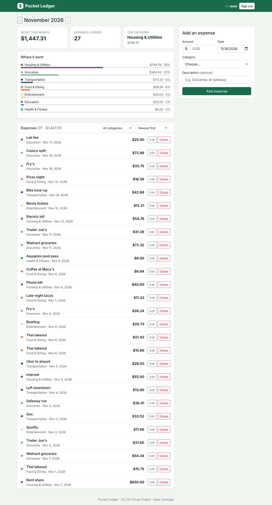
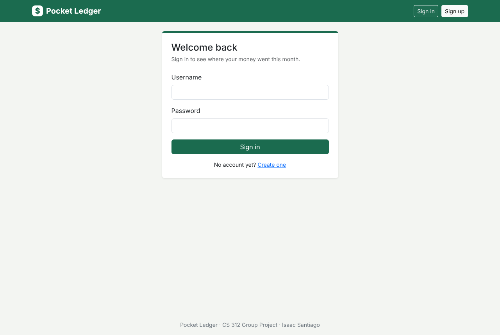
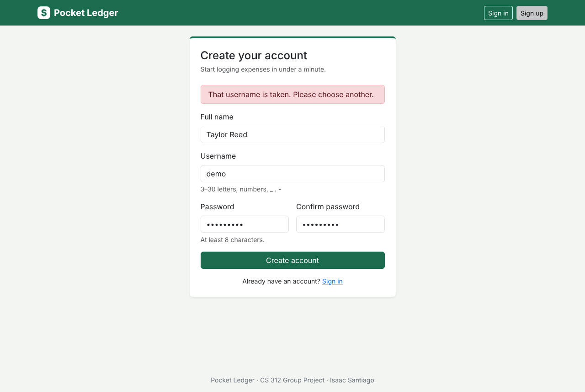
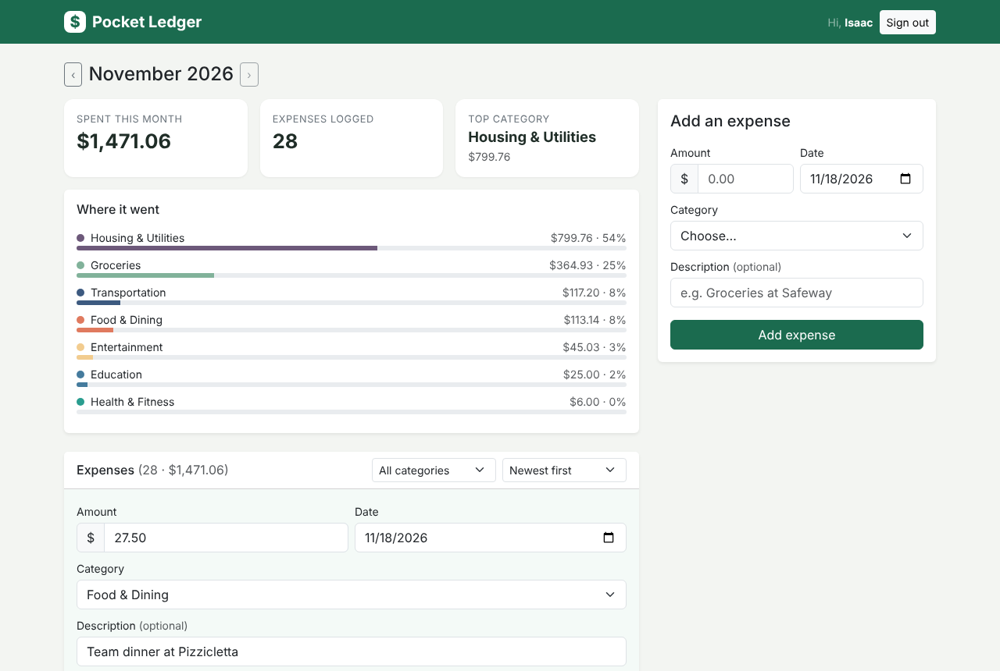
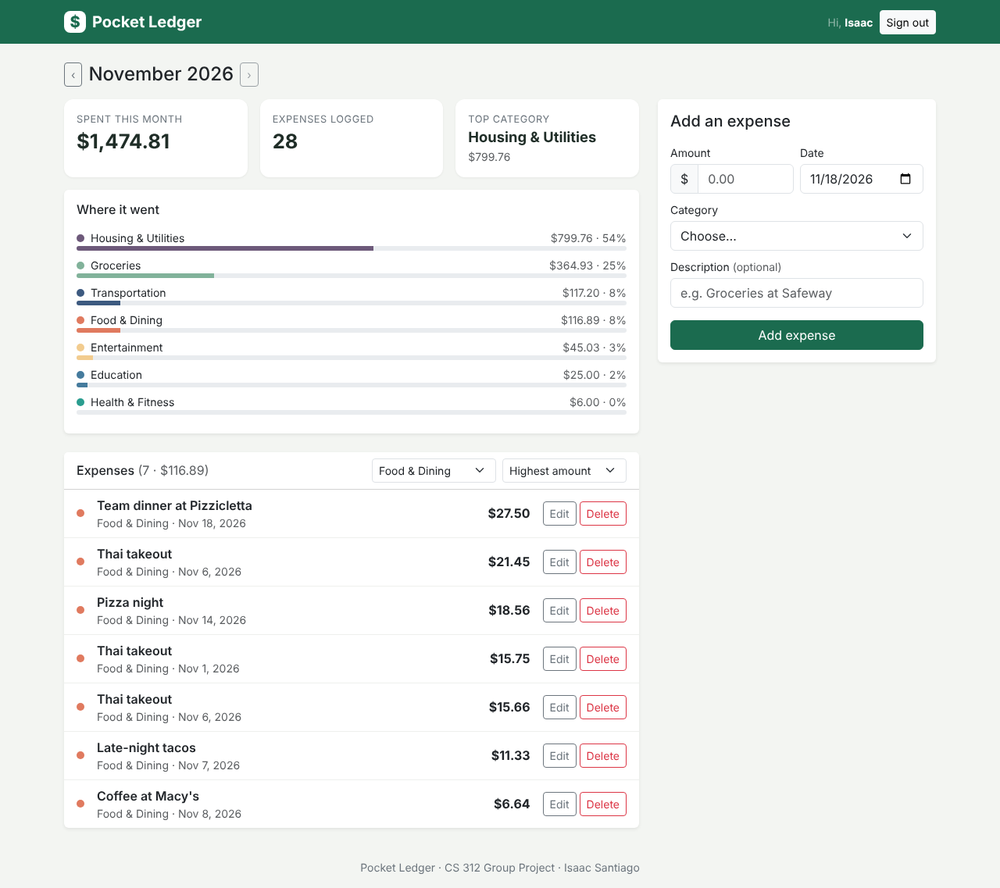
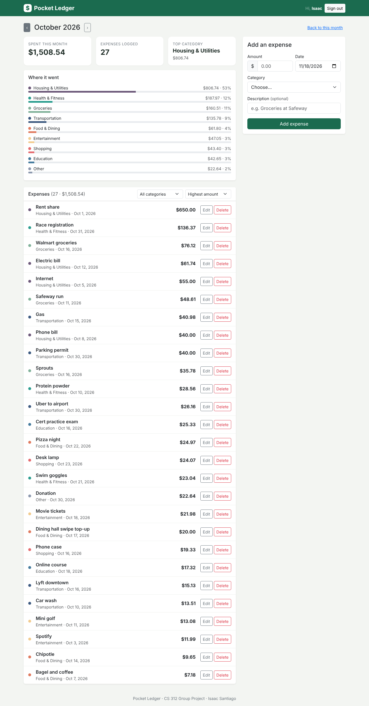
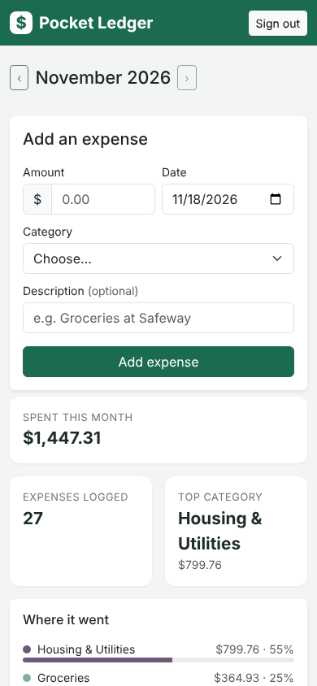

# Pocket Ledger: Expense Tracker Application

A PERN-stack (**P**ostgreSQL, **E**xpress.js, **R**eact, **N**ode.js) web app for logging, categorizing and reviewing personal expenses. CS 312 group project (solo team), built by Isaac Santiago.

**Status: Phase 1 complete.** Accounts, expense CRUD, categories, filtering and sorting, month navigation and a monthly snapshot all work. Phase 2 adds the full monthly summary, charts, budgets and custom categories.



## Phase-1 features

| Feature | Details |
|---|---|
| Accounts | Sign up (unique username, bcrypt-hashed password, confirm-password check), sign in, sign out. The session survives a page refresh. |
| Expense CRUD | Add, edit (inline, pre-filled) and delete expenses: amount, category, date and an optional description |
| Validation | Amount must be > 0 with at most 2 decimals; date and category are required. Checked in React **and** on the server. |
| Privacy | Every SQL query is scoped to the signed-in user's `user_id`; another user's expense IDs return 404 |
| Categories | 9 predefined, color-coded categories stored in a `categories` table |
| Filter and sort | Filter by category; sort by newest, oldest, highest or lowest amount |
| Month navigation | Step back through past months (future months are disabled) |
| Monthly snapshot | Month total, expense count, top category and a "where it went" breakdown with percentages |
| Responsive | Bootstrap 5 layout; on phones the add form moves above the list |

## Tech and structure

```
client/   React 19 + Vite, React Router, Axios       http://localhost:5173
  src/pages/       SignIn, SignUp, Dashboard
  src/components/  NavBar, ExpenseForm, ExpenseList, SummaryCards
server/   Express 5 JSON API, express-session, bcryptjs, pg   http://localhost:8000
  db/schema.sql    users, categories, expenses
  db/seed.sql      2 demo users + 126 expenses (Sep–Nov 2026)
```

### Database

| Table | Key columns |
|---|---|
| `users` | `user_id` SERIAL PK, `username` UNIQUE, `password` (bcrypt), `full_name`, `created_at` |
| `categories` | `category_id` SERIAL PK, `name` UNIQUE, `color` |
| `expenses` | `expense_id` SERIAL PK, `user_id` FK → users (ON DELETE CASCADE), `category_id` FK → categories, `amount` NUMERIC(10,2) CHECK > 0, `expense_date` DATE, `description`, `created_at`, `updated_at` |

### API

| Method | Route | Purpose |
|---|---|---|
| POST | `/auth/signup`, `/auth/signin`, `/auth/signout` | Account and session |
| GET | `/auth/me` | Current user (restores the session after a refresh) |
| GET | `/categories` | Category list |
| GET | `/expenses?month=YYYY-MM&category_id=&sort=` | The user's expenses with filters, plus the list total |
| GET | `/expenses/summary?month=YYYY-MM` | Totals by category for the dashboard cards |
| POST / PUT / DELETE | `/expenses`, `/expenses/:id` | Create, update, delete |

## Run it locally

1. **Database.** In pgAdmin, create a database named `ExpenseDB`. Run `server/db/schema.sql` and then `server/db/seed.sql` in its Query Tool, or use `npm run db:setup` (step 2).
2. **API**
   ```bash
   cd server
   cp .env.example .env     # set PGPASSWORD
   npm install
   npm run db:setup         # optional: creates the tables and demo data
   npm start
   ```
3. **Client** (second terminal)
   ```bash
   cd client
   npm install
   npm run dev              # open http://localhost:5173
   ```

**Demo accounts:** `isaac_s` / `Lumberjack26!` and `demo` / `Demo1234!`

## Screenshots

| Sign in | Sign up (username taken) |
|---|---|
|  |  |
| **Inline edit** | **Filtered and sorted** |
|  |  |
| **Previous month** | **Mobile** |
|  |  |

## Roadmap (Phase 2)

- Monthly summary page: average per day and a comparison with the previous month
- Donut and bar charts with click-to-filter drill-down
- Monthly budgets per category with 80% and over-budget warnings
- Custom categories, keyword search and CSV export
